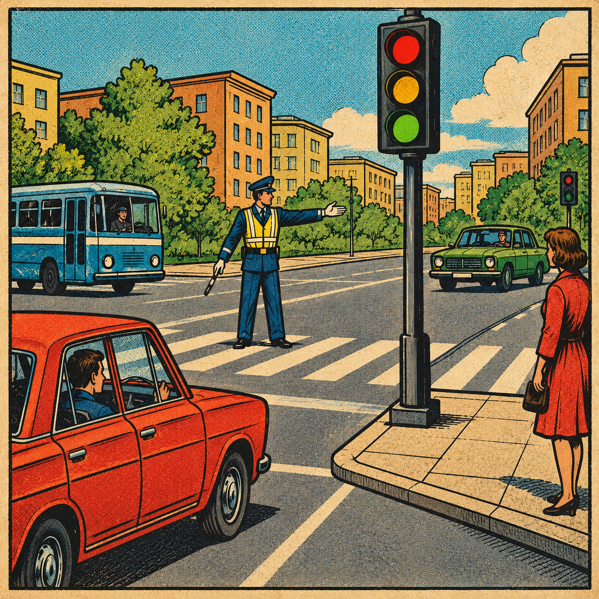

# ИДЗ №2 по курсу АКОС: Регулируемый перекрёсток

**Выполнил:** студент БПИ252 Гришин Алексей Андреевич  
**Вариант:** 39

[Полный отчёт по проекту (PDF)](./docs/report.pdf)

<div align="center">
  
</div>

## Описание проекта

Консольная многопоточная модель регулируемого перекрёстка на C. Автомобили и пешеходы прибывают с разных направлений, ожидают в ограниченных очередях и пересекают общую зону по сигналам светофора.

Каждое направление генерирует прибытия в своём потоке, каждый принятый участник получает собственный поток, а контроллер независимо переключает фазы. Основная версия использует POSIX Threads, один мьютекс состояния и семафоры уведомлений. Совместимые направления могут двигаться одновременно.

## Особенности реализации

* **Безопасность движения:** FIFO внутри полосы, симметричная матрица конфликтов, ограниченные очереди и проверка условий допуска под общим мьютексом.
* **Управление фазами:** фиксированный цикл и адаптивная стратегия по времени ожидания и длине очередей; экстренный транспорт получает приоритет с сохранением FIFO.
* **Реальное поведение участников:** собственное ожидание допуска и длительности проезда, независимо от задержки отображения.
* **Ограниченные ресурсы:** неподвижные контексты участников, повторное использование после `pthread_join`, обработка ошибок создания потоков и частичной инициализации.
* **Проверяемый журнал:** целые события в консоли и файле, общий номер события, монотонное время и итоговая статистика.
* **Штатная остановка:** период, цель, `SIGINT`/`SIGTERM`, недостижимая цель и ошибки; согласованный итог после сбора потоков.
* **POSIX-ввод-вывод:** `open`, `read`, `write`, `close`, повторение коротких записей и вызовов, прерванных `EINTR`.

## Сборка и запуск

Нужны CMake 3.20+, компилятор C17 с POSIX Threads и Python 3.8+ для тестов. Свой компилятор можно задать через `CC`.

```bash
# Сборка, все тесты и журналы четырёх примеров
./tests/run.sh

# Отдельная сборка с ThreadSanitizer
./tests/run.sh tsan

# Сборка и проверки без санитайзеров
./tests/run.sh none

# Запуск программы
./build/crossroad data/demo.conf results/demo.log
./build/crossroad --help
```

Те же команды работают в Linux, например `CC=gcc ./tests/run.sh asan`. Режимы `asan`, `tsan` и `none` используют каталоги `build`, `build-tsan` и `build-plain`. По умолчанию включены ASan и UBSan; одновременно с TSan их включать нельзя. Переменные `BUILD_DIR` и `RESULTS_DIR` меняют каталоги сборки и журналов примеров.

Для сборки только программы Python не нужен:

```bash
cmake -S . -B build-release -DCMAKE_BUILD_TYPE=Release -DBUILD_TESTING=OFF
cmake --build build-release --parallel
./build-release/crossroad data/demo.conf demo.log
```

Интерфейс: `crossroad CONFIG [LOG]`. Без второго аргумента журнал записывается в `crossroad.log`. `Ctrl+C` или `SIGTERM` останавливает работающую модель с выводом итоговой статистики.

## Конфигурация

Все параметры задаются в одном текстовом файле. Комментарий начинается с `#`, позднее значение параметра заменяет предыдущее.

```text
ticks 100
seed 39
strategy adaptive
min_green 2
max_green 5
clearance 1
priority 1
emergency_rate 30
tick_ms 10
delay_ms 100

stream N car north straight 4 2 500
stream S car south straight 4 2 500
stream P pedestrian east walk 2 3 100
conflict N S 0
phase cars N S
phase pedestrians P
```

Форматы записей:

```text
stream NAME KIND DIRECTION MANEUVER CAPACITY CROSSING_TICKS RATE
conflict NAME_A NAME_B VALUE
phase NAME STREAM_1 STREAM_2 ...
```

`KIND`: `car` или `pedestrian`; `DIRECTION`: `north`, `east`, `south`, `west`. Для автомобилей доступны `straight`, `right`, `left`, для пешеходов — `walk`. `RATE` — вероятность прибытия в тысячных долях на такт: `1000` означает попытку прибытия на каждом обработанном такте.

Вместимость очереди — от 1 до 64 ожидающих; участник в зоне в неё не входит. Время пересечения — от 1 до 1000 тактов, не больше `max_green`. Поддерживаются до 16 направлений и 16 фаз. Каждый поток должен обслуживаться хотя бы одной фазой, а направления одной фазы должны быть совместимы.

По умолчанию направления конфликтуют. `conflict A B 0` разрешает совместное движение, `conflict A B 1` запрещает его; изменение симметрично. Конфликт направления с самим собой отключать нельзя.

| Параметр | Назначение | По умолчанию |
|---|---|---|
| `ticks` | Период наблюдения в тактах; `0` отключает предел | `120` |
| `target` | Целевое число зарегистрированных выходов; `0` отключает цель | `0` |
| `seed` | Начальное значение генераторов, от `0` до `4294967295` | `39` |
| `strategy` | `fixed` или `adaptive` | `adaptive` |
| `min_green`, `max_green` | Минимальное и максимальное окно допуска в тактах | `4`, `10` |
| `clearance` | Защитный интервал после освобождения зоны, в тактах | `2` |
| `priority` | Приоритет экстренного транспорта: `0` или `1` | `1` |
| `emergency_rate` | Доля экстренных автомобилей в тысячных долях | `20` |
| `tick_ms` | Длительность модельного такта в миллисекундах | `1` |
| `delay_ms` | Минимальный интервал между сообщениями `Состояние`, в миллисекундах | `0` |

`ticks` и `target` ограничены числом `1000000000`. Длительности фаз — от 1 до 10000 тактов, `min_green <= max_green`. `tick_ms` — от 1 до 60000, `delay_ms` — от 0 до 60000. Ошибочная конфигурация отклоняется до запуска модели; входной файл защищён от перезаписи журналом.

## Время и правила движения

Все интервалы измеряются через `CLOCK_MONOTONIC`. При `tick_ms 10` проезд длительностью 3 такта занимает не менее 30 мс. Участник сам выдерживает срок проезда вне мьютекса; уведомление не позволяет завершить его раньше.

`delay_ms` влияет только на частоту снимков `Состояние`. При `delay_ms 0` снимок выводится не чаще одного раза за такт, остальные события — сразу. Ускоренный режим: `tick_ms 1`, `delay_ms 0`. Для наблюдения в терминале можно установить `tick_ms 100`, `delay_ms 100`.

Контроллер выполняет переходы:

```text
GREEN → DRAIN → CLEARANCE → GREEN
```

В `GREEN` въезд разрешён при соблюдении всех условий: голова FIFO, свободное направление, отсутствие конфликтов, действующая фаза, неистёкший срок допуска и отсутствие остановки. Проверка условий и занятие зоны выполняются одной операцией под мьютексом.

После закрытия въезда контроллер переходит в `DRAIN` и ждёт выхода уже движущихся участников. Их зелёные сигналы сохраняются. Затем все сигналы выключаются, полностью выдерживается `CLEARANCE` и включается следующая фаза. `max_green` ограничивает новый въезд, а начатый проезд может завершиться в `DRAIN`.

Фиксированная стратегия циклически обходит фазы. Адаптивная выбирает фазу с самым долгим ожиданием головного участника; при равенстве учитывает суммарную длину очередей, затем порядок циклического обхода. Приоритет выбирает фазу старейшего экстренного запроса, сохраняя минимальное зелёное время, защитный интервал и FIFO внутри полосы. Пешеходный запрос регистрируется при принятии пешехода в очередь.

## Потоки и синхронизация

Главный поток запускает и собирает рабочие потоки, принимает сигналы и выводит снимки состояния. Контроллер переключает фазы; направления создают прибытия; каждый принятый участник самостоятельно ожидает и пересекает зону.

Очереди, сигналы, занятость зоны, статистика и причина остановки защищены одним мьютексом. Конфигурация после загрузки неизменяема. Семафор сообщает о необходимости повторно проверить состояние и не заменяет проверку допуска. Ожидания, задержки проезда и `pthread_join` выполняются без удержания мьютекса.

Каждому направлению выделены `capacity + 1` контекстов: места для очереди и одного пересекающего участника. Контекст и семафор не перемещаются и не переиспользуются до успешного `pthread_join`. Направление своевременно собирает завершившиеся потоки, а при остановке оставшиеся собирает главный поток. Ошибка `pthread_create` регистрируется как отказ, резервирование откатывается и начинается общая остановка.

У каждого направления собственное состояние SplitMix64, заданное `seed` и индексом направления. На такт отводятся два числа: прибытие и экстренность. Пропущенные такты продвигают генератор без создания запоздалых прибытий. Направления не влияют на последовательности друг друга; фактически обработанные такты, глобальные идентификаторы и полный порядок журнала зависят от планировщика.

## Завершение и журнал

Модель останавливается по первому зафиксированному условию: истечение периода, достижение цели, `SIGINT`/`SIGTERM`, отсутствие возможности достичь цели при нулевых интенсивностях либо ошибка.

* При `ticks > 0` новые прибытия и въезды разрешены строго до границы периода. Выход учитывается, если зарегистрирован не позже этой границы.
* При `target > 0` допуск проверяет `passed + active < target`, поэтому совместимые направления не превышают цель.
* После остановки статистика замораживается. Ожидающие остаются в очередях, незавершённые пересечения — в категории `в_зоне`; пробуждение и `pthread_join` не засчитывают их как прошедших.
* `SIGINT`/`SIGTERM` блокируются до создания рабочих потоков и принимаются главным потоком через `sigwait`. Повторные сигналы не прерывают освобождение ресурсов.

Порядок завершения: закрыть прибытия и допуск, разбудить ожидающих, собрать потоки, вывести итог, уничтожить примитивы и закрыть журнал. Нулевые `ticks` и `target` задают работу до прерывания, ошибки или исчерпания входов.

Каждая строка журнала содержит `[t=N]`, предметное событие, возрастающий номер `событие` и `время_нс` от начала модели. Строки целиком записываются в консоль и файл под мьютексом модели; при отказе одного канала исправный продолжает работать.

В итоге выводятся прибытия, прошедшие, отказы, ожидающие, участники в зоне, пик очереди и время ожидания. Поле `потоков` показывает общее число созданных потоков участников, включая уже собранные. Для каждого направления и всей модели выполняется:

```text
прибыло = отказов + прошло + ожидают + в_зоне
```

Ожидание прошедшего участника — число целых тактов между прибытием и въездом; среднее вычисляется по прошедшим участникам. Коды возврата: `0` — штатное завершение, `1` — ошибка выполнения или вывода, `2` — ошибка аргументов или конфигурации, `3` — недостижимая цель, `128 + номер сигнала` — прерывание.

## Структура проекта

| Файл | Назначение |
|---|---|
| `src/main.c` | Аргументы, подготовка сигналов, открытие и закрытие журнала |
| `src/config.c`, `src/crossroad.h` | Конфигурация, предметные типы и публичные интерфейсы |
| `src/simulation.c` | Запуск и сбор потоков, приём сигналов, журнал и итог |
| `src/simulation.h`, `src/simulation_state.c` | Общее состояние, примитивы, остановка и инварианты |
| `src/simulation_time.c` | Монотонные часы и прерываемые ожидания |
| `src/participants.c` | Направления, генераторы, FIFO, допуск и проезд участников |
| `src/controller.c` | Выбор фаз и автомат контроллера |
| `src/io.c` | Ввод-вывод через файловые дескрипторы |
| `data/`, `tests/` | Конфигурации, предметные тесты и нагрузочные прогоны |
| `docs/report.pdf` | Отчёт ИДЗ №2 |

## Тестирование и результаты

CTest запускает пять тестов: `state`, `participants`, `lifecycle`, `scenarios`, `stress`. Проверяются конфигурация, конфликты, FIFO, вместимость, время проезда и фаз, совместное движение, устаревшие уведомления, точная цель, сигналы во всех состояниях контроллера и ошибки вывода.

`lifecycle` выполняет два запуска по 1000 проездов при пяти контекстах, проверяет их переиспользование, `pthread_join`, ошибки `pthread_create` и частичного создания семафоров. `tests/check_log.py` независимо восстанавливает модель по событиям. Консоль и файл сравниваются внутри одного запуска; журналы разных запусков не обязаны совпадать.

Нагрузка содержит 48 запусков: две стратегии, два сценария, четыре `seed` (`0`, `1`, `39`, `4294967295`) и три повтора. Один сценарий завершается по периоду, другой — после 80 выходов. Тайм-аут отдельного запуска — 10 секунд, всего теста — 180 секунд.

```bash
# Только нагрузка уже собранной программы
ctest --test-dir build -L stress --output-on-failure

# Собственные параметры нагрузки
python3 tests/stress.py build/crossroad --seeds 2 7 39 --repeat 5 --timeout 20
STRESS_REPEATS=5 STRESS_TIMEOUT=20 ./tests/run.sh tsan
```

Отчёт сохраняется в `<build>/stress/summary.json`. При ошибке конфигурация, журнал, консоль и stderr остаются в `<build>/stress/failure/`.

Проверено 23 октября 2026 года:

| Платформа | Режим | CTest | Нагрузка |
|---|---|---|---|
| macOS arm64, Clang 22.1.8 | ASan/UBSan | 5/5 | 48/48 |
| macOS arm64, Clang 22.1.8 | TSan | 5/5 | 48/48 |
| Debian 12 arm64, GCC 12.2.0 | Без санитайзеров | 5/5 | 48/48 |
| Debian 12 arm64, GCC 12.2.0 | ASan/UBSan | 5/5 | 48/48 |

## Отчёт

В отчёте приведены условие, распределение сущностей по потокам, правила синхронизации и остановки, результаты запусков.
